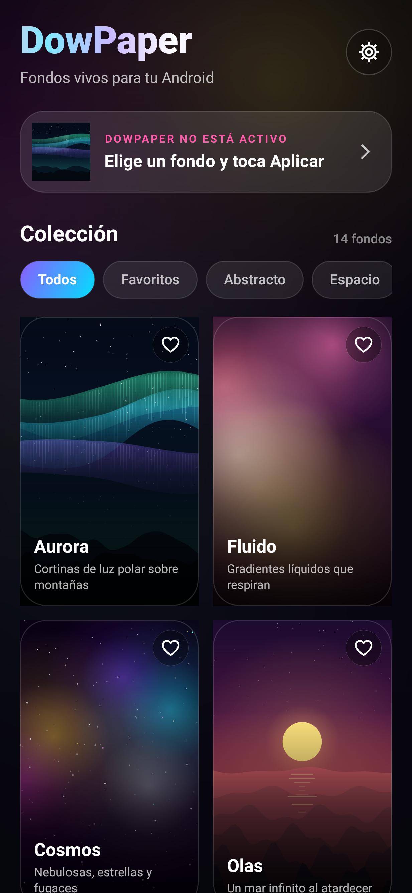
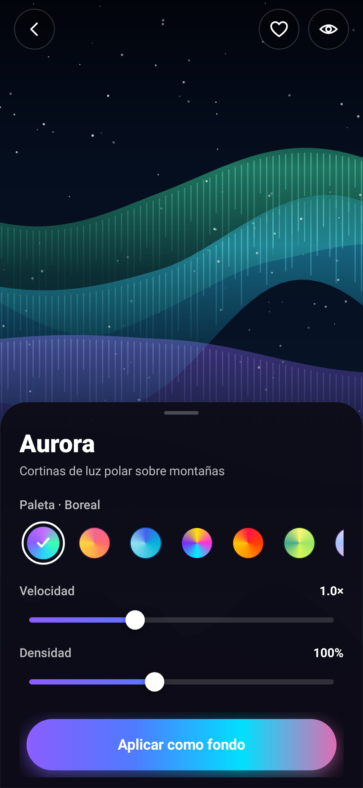
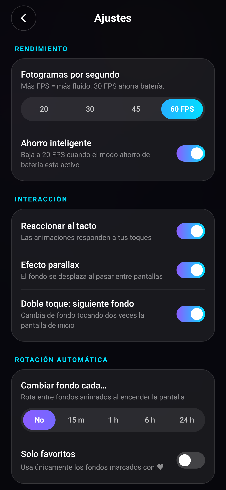
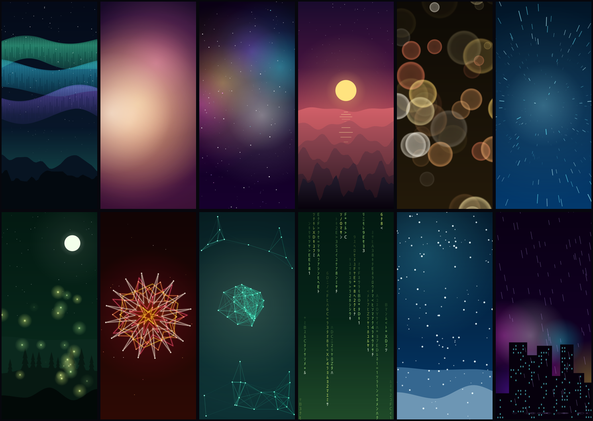

# DowPaper — Fondos de pantalla animados para Android

DowPaper es una app de **fondos de pantalla animados (live wallpapers)** para Android.
Todas las animaciones se generan en tiempo real con código (sin videos ni imágenes
pesadas), así que el APK pesa **menos de 200 KB**, no necesita internet y no pide permisos.

<p align="center">
  
  
  
</p>

## Descargar

El APK firmado está en [`release/DowPaper-v1.0.0.apk`](release/DowPaper-v1.0.0.apk).
Cópialo al teléfono, ábrelo y permite *instalar apps de origen desconocido* si Android lo pide.
Requiere **Android 8.0 (API 26) o superior**.

## Fondos incluidos



| Fondo | Descripción | Al tocar |
|---|---|---|
| **Aurora** | Cortinas de luz polar sobre montañas y estrellas | La aurora se intensifica |
| **Fluido** | Gradientes líquidos que respiran (mesh gradient) | Una mancha sigue tu dedo |
| **Cosmos** | Nebulosas, 3 capas de estrellas y estrellas fugaces | Onda + estrella fugaz |
| **Olas** | Mar infinito al atardecer con reflejos del sol | Onda expansiva en el agua |
| **Bokeh** | Luces suaves fuera de foco | Las luces se apartan |
| **Hiperespacio** | Viaje a la velocidad de la luz | Salto hiperespacial hacia tu dedo |
| **Luciérnagas** | Bosque mágico bajo la luna | Las luciérnagas te rodean |
| **Mandala** | Geometría sagrada que gira y se transforma | Giro acelerado |
| **Red Neural** | Nodos conectados en movimiento | Los nodos se conectan a ti |
| **Código** | Lluvia digital de glifos | Ráfaga en la columna tocada |
| **Nevada** | Copos tranquilos con colinas nevadas | Ráfaga de viento |
| **Lluvia** | Tormenta nocturna sobre la ciudad con relámpagos | Relámpago |
| **Tu foto** | Tu imagen con zoom vivo (Ken Burns), parallax y un efecto encima (bokeh, nieve, lluvia, luciérnagas, estrellas) | — |
| **Tu video** | Cualquier video en bucle, silenciado y recortado a la pantalla | — |

## Opciones

- **10 paletas de color** por fondo (Boreal, Atardecer, Océano, Neón, Lava, Bosque, Lavanda, Menta, Oro, Mono).
- **Velocidad** (0.2× – 2.5×) y **densidad** (30 % – 200 %) de cada fondo, con vista previa en vivo.
- **Favoritos** ♥ y filtros por categoría.
- **FPS**: 20 / 30 / 45 / 60 y **ahorro inteligente** (baja a 20 FPS con el modo ahorro de batería).
- **Parallax** al deslizar entre pantallas de inicio.
- **Interacción táctil** en el fondo.
- **Doble toque** en la pantalla de inicio para pasar al siguiente fondo.
- **Rotación automática** cada 15 min / 1 h / 6 h / 24 h (todos o solo favoritos).
- Cada fondo recuerda su propia configuración. El fondo se pausa automáticamente cuando no se ve.

## Cómo compilar

### Opción A — Android Studio / Gradle (recomendado)

Abre la carpeta del proyecto en Android Studio (Ladybug o superior) y ejecuta,
o desde la terminal:

```bash
./gradlew assembleRelease
# APK en app/build/outputs/apk/release/
```

También hay un workflow de GitHub Actions (`.github/workflows/build.yml`) que compila
el APK en cada push y lo deja como artefacto descargable.

### Opción B — `build.sh` (sin Gradle ni Android Gradle Plugin)

Útil en entornos sin acceso a Google Maven. Usa solo herramientas de línea de comandos:
`aapt2`, `kotlinc`, `proguard`, `dx`, `zipalign` y `apksigner`.

```bash
# Ubuntu/Debian
sudo apt install aapt apksigner zipalign dalvik-exchange openjdk-21-jdk
# android.jar (API 35 para compilar, API 34 para enlazar recursos) y el compilador de Kotlin 2.0.21
# en /opt/android-sdk/platforms/android-XX/ y /opt/kotlinc (rutas configurables por variables de entorno)
./build.sh
# → build/DowPaper-v1.0.0.apk
```

### Vista previa sin teléfono

`tools/preview` renderiza cada escena y las pantallas de la app a PNG en la JVM
(Robolectric con gráficos nativos). Tras `./build.sh`:

```bash
cd tools/preview && gradle test   # imágenes en docs/screenshots/
```

## Estructura

```
app/src/main/kotlin/com/dowpaper/android/
├── core/        Paletas, preferencias, catálogo de fondos, ruido procedural
├── scenes/      Las 12 escenas animadas + foto (Canvas, compartidas por app y fondo)
├── wallpaper/   DowPaperService (escenas) y DowVideoService (video)
└── ui/          MainActivity, pantallas y widgets dibujados a mano
```

- La UI es 100 % nativa (framework de Android, sin AndroidX ni librerías externas):
  botones con gradiente animado, sliders, interruptores, chips y transiciones propias.
- La misma clase `Scene` dibuja la vista previa de la app y el fondo real, así que lo que
  ves es exactamente lo que obtienes.
- El video usa un servicio separado porque un `Surface` dibujado con Canvas no puede
  ser reutilizado por `MediaPlayer`.

## Firma

El APK se firma con `keystore/dowpaper-release.jks` (contraseña `dowpaper`), incluido en el
repositorio para que las actualizaciones futuras se instalen encima de la versión actual.
**Si vas a publicar en Google Play, genera un keystore nuevo y guárdalo fuera del repositorio**
(las variables `DOWPAPER_KEYSTORE`, `DOWPAPER_KS_PASS` y `DOWPAPER_KS_ALIAS` lo permiten en Gradle,
y `KEYSTORE` / `KS_PASS` / `KS_ALIAS` en `build.sh`).
